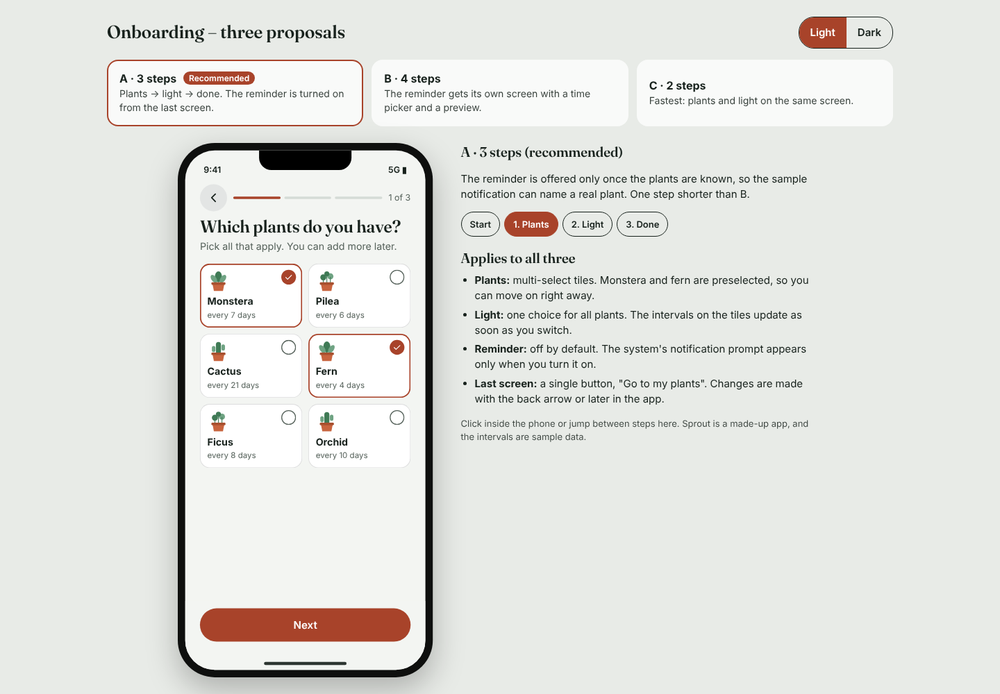
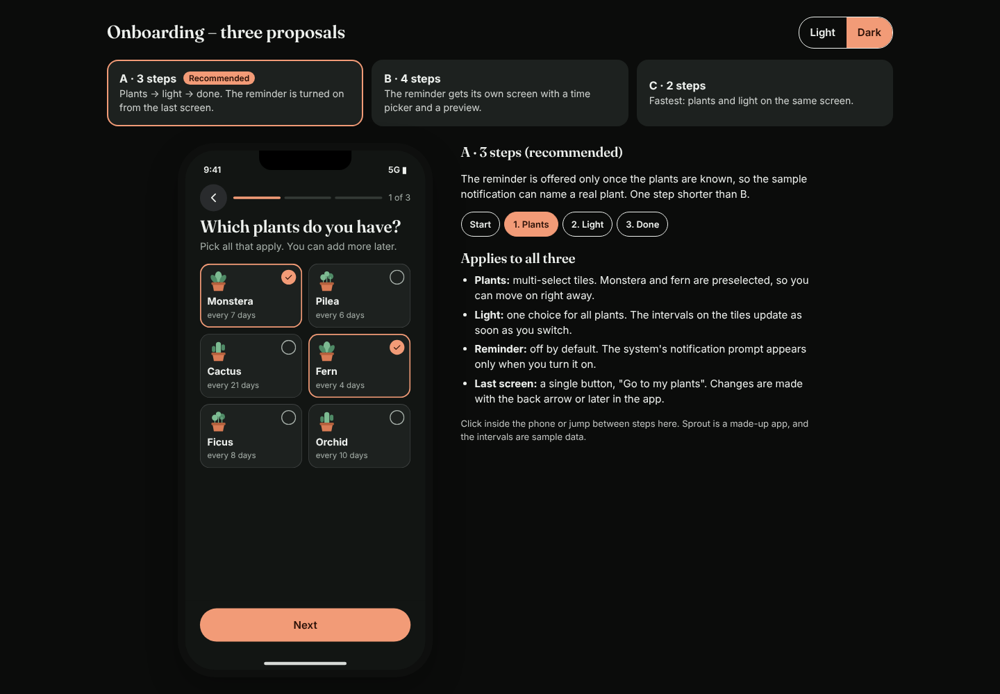

# design-mockup

A skill for Claude that presents design proposals as a **clickable HTML mockup page** in a fixed format, so you can compare 2–3 alternatives before anything gets built. It works for any project and platform: web, iOS, Android, desktop or game UI.

| Light | Dark |
|---|---|
|  |  |

## What it does

When you ask Claude for a design proposal ("show me some options", "what would it look like?", "give me alternatives"), it builds a page with:

- **Proposal cards**: 2–3 alternatives, with the recommended one first and labelled.
- **A device frame**: it shows your app's real look (fonts, colours, images, components), and you can click through it. The frame matches your platform: iPhone, Android, tablet, browser, desktop window or game resolution.
- **Step buttons** for jumping between the screens in the flow.
- **Notes** on what sets each proposal apart and what they have in common, plus sub-proposals for single parts of a screen.
- **A light/dark toggle.**
- **Linkable states** in the URL, for example `#alt=C&i=0&dark=1`.

Before showing you the page, Claude screenshots every step in both themes. It reviews them like a designer would, checking spacing, overlap, text wrapping and contrast. Nothing gets built until you pick a proposal.

The template in `design-mockup/example/` is the onboarding flow of **Sprout**, a made-up plant-watering app. Claude swaps its fonts, colours and images for your project's, read from your theme files.

## Install

**Any agent, with the [skills](https://skills.sh) CLI**

```bash
npx skills add haxnax/design-mockup
```

**Claude Code, by hand**

Copy the `design-mockup` folder into one of these:

- `~/.claude/skills/` to use it in every project (on Windows: `C:\Users\<you>\.claude\skills\`)
- `.claude/skills/` inside a project to use it only there

```bash
git clone https://github.com/haxnax/design-mockup.git
cp -r design-mockup/design-mockup ~/.claude/skills/
```

**Claude app (claude.ai)**

Download `design-mockup.zip` from [Releases](../../releases) and upload it under Skills in settings.

## Use

Type `/design-mockup`, or just ask for a design proposal in plain words, for example *"Show me three options for the onboarding flow"*.

The skill works best when Claude can start a local server and open the page in a browser. It needs Python for `http.server`, and ideally Chrome for the screenshots.

To try the example on its own, run this from the repository root and open `http://127.0.0.1:8000/example/`:

```bash
cd design-mockup && python -m http.server 8000 --bind 127.0.0.1
```

## License

- The skill (`SKILL.md`) and the example page (`example/index.html`): [MIT](LICENSE).
- The bundled fonts, Inter and Fraunces: [SIL Open Font License 1.1](design-mockup/example/fonts/OFL.txt).
